# PlayerLoad-Risk — Explainable Injury & Availability Risk Modelling

An end-to-end ML system that estimates an athlete's **short-term (7-day) availability risk** from
GPS-style training and match-load data — with leakage-free temporal features, athlete-specific
baselines, calibrated probabilities, SHAP explanations, a what-if simulator, a REST API, a
dashboard, experiment tracking, data validation and drift monitoring.

> [!IMPORTANT]
> **This project estimates statistical availability risk from workload patterns. It is not a
> medical diagnostic system.** It does not predict that any individual *will* be injured. All
> bundled data is **synthetic** and describes no real athlete.

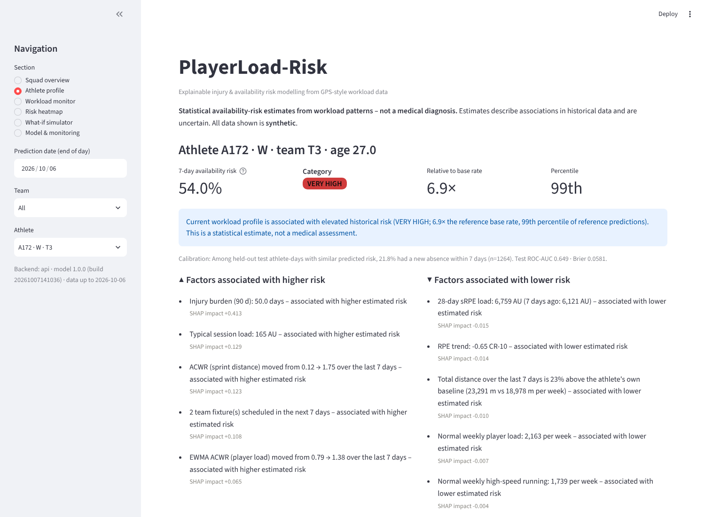

---

## Contents

1. [Why this project](#why-this-project)
2. [Quick start](#quick-start)
3. [Architecture](#architecture)
4. [Data](#data)
5. [Feature engineering & workload methodology](#feature-engineering--workload-methodology)
6. [Modelling](#modelling)
7. [Temporal validation & leakage prevention](#temporal-validation--leakage-prevention)
8. [Results](#results)
9. [Explainability](#explainability)
10. [Risk engine](#risk-engine)
11. [What-if simulation](#what-if-simulation)
12. [API](#api)
13. [Dashboard](#dashboard)
14. [MLOps](#mlops)
15. [Testing](#testing)
16. [Limitations](#limitations)
17. [Ethical considerations](#ethical-considerations)
18. [Repository layout](#repository-layout)

---

## Why this project

Performance staff collect huge volumes of GPS data and are asked a deceptively simple question:
*"Who should we be careful with this week?"* Most public examples answer it with a random
train/test split of a Kaggle-style table and a headline accuracy. That is wrong in three ways:

* **Time** – athlete-days are autocorrelated; random splits leak the future into training.
* **Rarity** – weekly absence rates are ~7 %; accuracy is meaningless, calibration matters.
* **Science** – popular heuristics such as the acute:chronic workload ratio (ACWR) are
  contested; a model should *test* them, not encode them.

This repository is built around those three problems.

## Quick start

### Docker (full stack)

```bash
docker compose up --build
```

| service | URL |
|---|---|
| API | http://localhost:8000 |
| API docs (OpenAPI/Swagger) | http://localhost:8000/docs |
| Dashboard | http://localhost:8501 |
| MLflow | http://localhost:5000 |

Start-up sequence: PostgreSQL and MLflow become healthy → a one-shot `bootstrap` job seeds the
database from the bundled synthetic CSVs, re-trains all models (≈ 1.5 min, logged + registered
in MLflow) and writes a drift report → the API starts → the dashboard starts. A pre-trained model
is bundled, so if training fails the stack still comes up. Skip re-training with
`TRAIN_ON_STARTUP=false docker compose up`.

### Netlify (static dashboard, one click)

[](https://app.netlify.com/start/deploy?repository=https://github.com/AzizKhayati1/Injurypred)

The `web/` folder is a self-contained single-page dashboard (no build step, no CDN) that Netlify
serves as-is; `netlify.toml` already sets the base/publish directory (`web`), the SPA rewrite
rules and headers, and keeps Netlify from trying to install the Python stack. Options:

* **Git deploy** – *Add new site → Import from Git*, pick this repo; Netlify reads `netlify.toml`
  (base directory `web`, nothing to build). Every push redeploys.
* **Drag & drop** – drop the `web/` folder onto <https://app.netlify.com/drop>
  (`web/_redirects` carries the same routing rules).
* **CLI** – `npx netlify-cli deploy --dir web --prod`.

Netlify hosts static files (its functions run JavaScript/Go), so the Python model does not run
there: `make web` runs the real pipeline once and writes every view, explanation and what-if
sweep to `web/data/` (≈ 5 MB, ≈ 1 MB compressed). Re-run it after retraining and commit the
result. To evaluate arbitrary what-if combinations live, host the FastAPI service elsewhere
(any Docker host) and set `apiUrl` in `web/config.js`; the simulator then shows a
"Custom combination (live API)" panel.

Routing uses real URLs that can be bookmarked, shared and reloaded:

| URL | view |
|---|---|
| `/squad` (`?team=T1`) | squad overview |
| `/athletes` (`?team=&pos=&status=&q=`) | searchable, sortable athlete list (filters kept in the URL) |
| `/athletes/A172` | explained risk estimate, risk history, personal baseline, absences |
| `/athletes/A172/workload` (`?days=90`) | workload monitor |
| `/simulator`, `/simulator/A172` (`?dim=sprint_load_pct`) | what-if simulator |
| `/heatmap` (`?team=&days=28`) | athletes × dates risk heatmap |
| `/model`, `/about` | performance & drift, methodology |

Preview locally with the same routing rules: `make web-serve` → <http://127.0.0.1:8080>.

| Squad overview | Athlete |
|---|---|
| 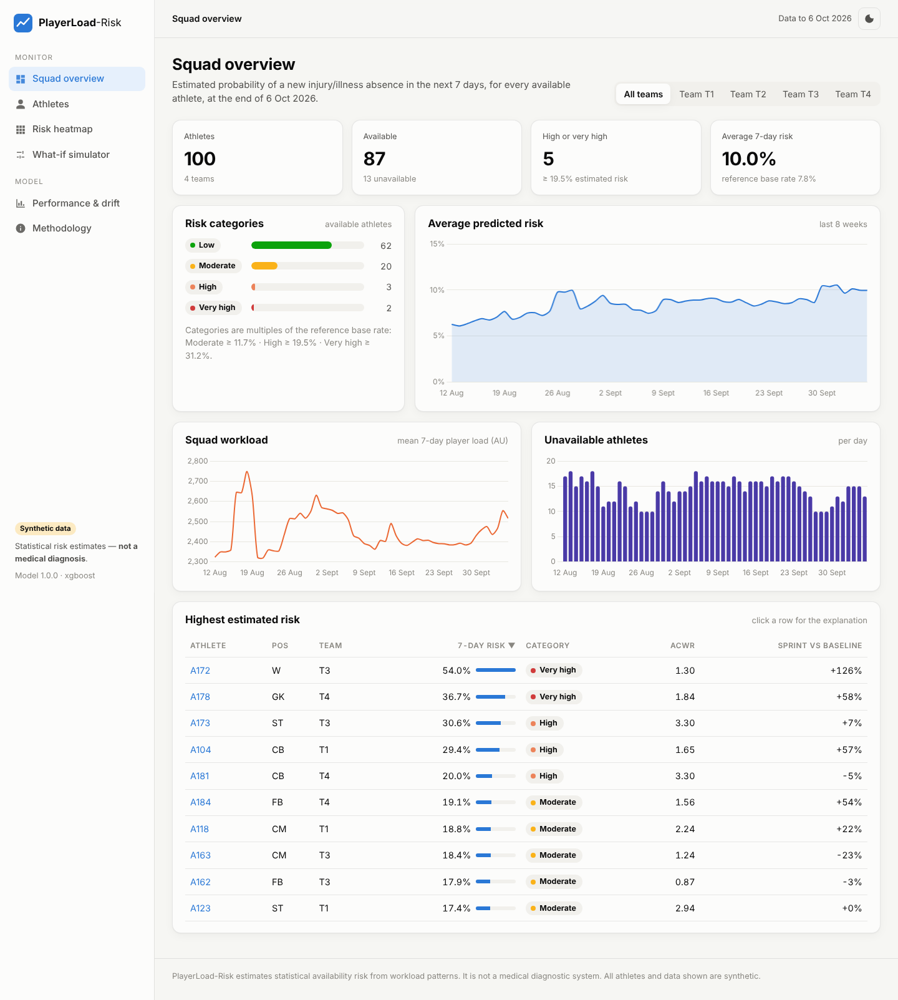 | 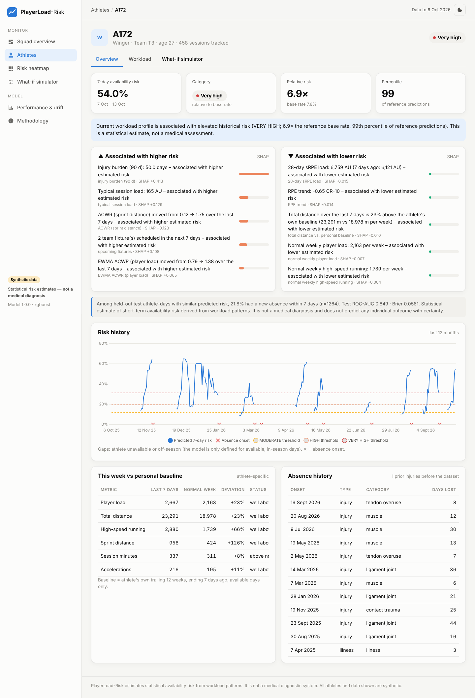 |
| **What-if simulator** | **Mobile** |
| 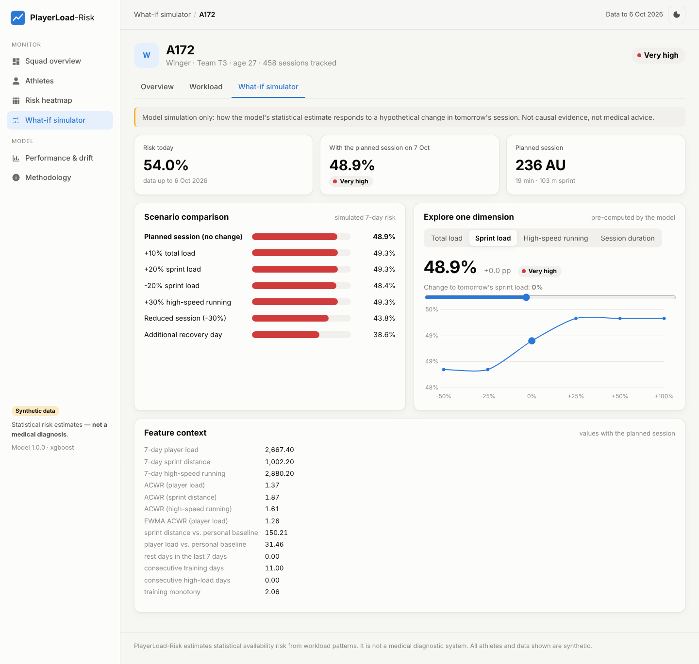 | 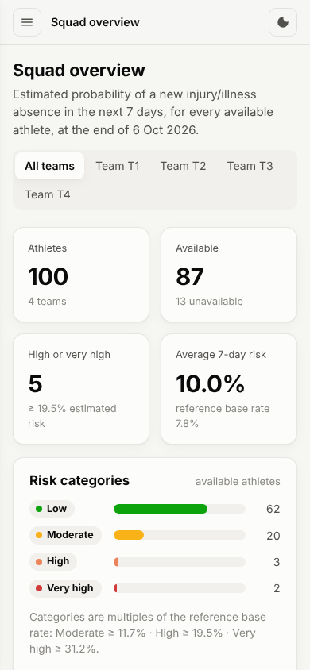 |

### Local (Python ≥ 3.11)

```bash
pip install -r requirements-dev.txt
make test          # 98 unit + integration tests
make train         # validate → features → 5 models → select → evaluate → register (MLflow, local SQLite)
make api           # http://localhost:8000/docs
make dashboard     # http://localhost:8501 (uses the API if running, otherwise in-process)
make experiments   # workload-representation & class-imbalance experiments
make monitor       # drift report → reports/monitoring/drift_report.html
make mlflow-ui     # http://localhost:5000
```

## Architecture

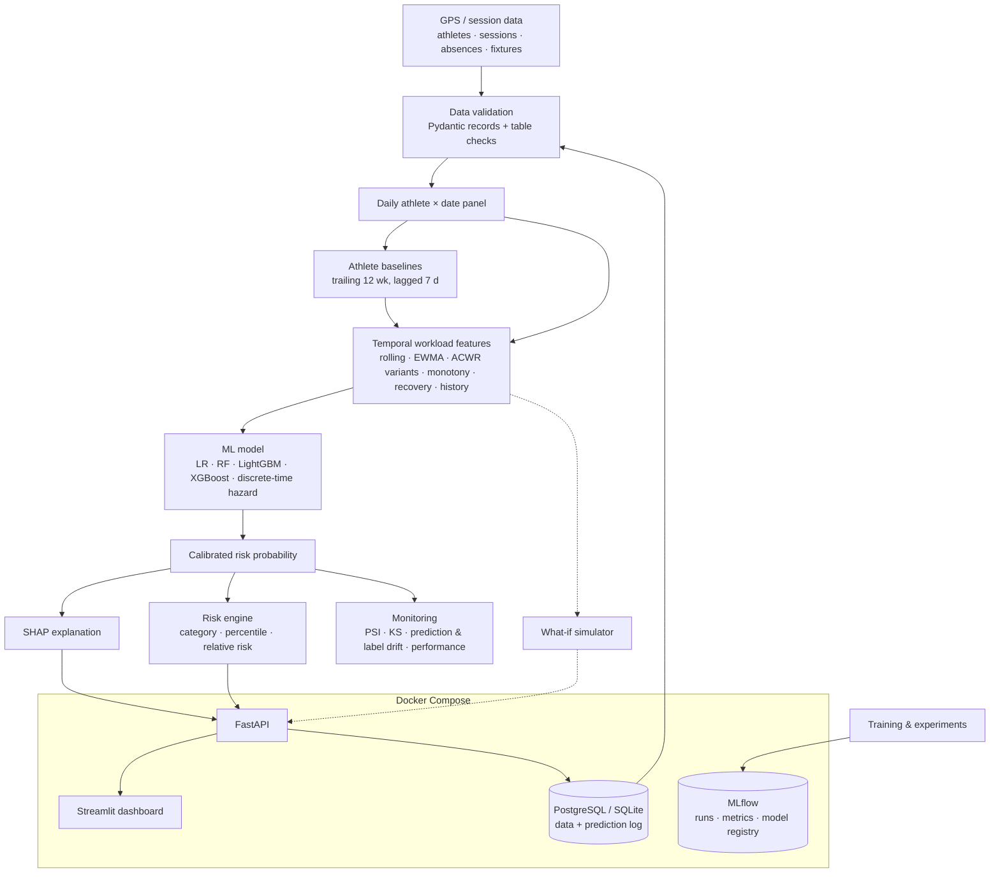

Business logic lives in `src/` and is exposed through one application service
(`src/service.py`). The API (`api/`) and dashboard (`dashboard/`) are thin presentation layers;
the dashboard is an API client (with an in-process fallback for local development).

## Data

The default demo uses a **synthetic but temporally realistic** dataset (`src/data/synthetic.py`,
fully seeded) because professional GPS/injury data is proprietary health data. Details and the
public-data discussion are in [`docs/data.md`](docs/data.md).

* 100 athletes in 4 squads (GK, CB, FB, CM, W, ST), 2 full seasons + the current season to
  2026-10-06 — 55,953 sessions, 553 injuries, 161 illnesses.
* Football micro-cycles (MD-4 … MD+1), pre-season ramps, congested weeks, winter breaks,
  off-seasons, team intensification spikes, return-to-play phases, match selection.
* **Hidden athlete traits** (workload tolerance, injury susceptibility, recovery capacity) drive
  a daily injury hazard but are **never** given to the model.
* The ground truth is a fitness–fatigue / sprint-exposure / recovery / re-injury hazard with a
  load-independent contact component — **not** an ACWR formula — so the model must discover what
  matters.
* An **intentional drift** in the current season (two teams emphasise high-speed running)
  gives the monitoring module something real to detect.

Every table has `data_origin = synthetic`; the API echoes it in every prediction.

## Feature engineering & workload methodology

76 features, computed by one pipeline (`src/features/build.py`) used for training, serving and
simulation (no train/serve skew). Full rationale: [`docs/methodology.md`](docs/methodology.md).

| group | features (examples) |
|---|---|
| Load (7 d) | `total_distance_7d`, `high_speed_distance_7d`, `sprint_distance_7d`, `sprint_count_7d`, `accelerations_7d`, `decelerations_7d`, `player_load_7d`, `srpe_load_7d` |
| 14 d / chronic (28 d) | `player_load_14d`, `total_distance_28d`, `sprint_distance_28d`, `player_load_28d` |
| Ratios | `acwr_total_load`, `acwr_sprint_load`, `acwr_high_speed_load`, uncoupled ACWR, EWMA ACWRs |
| Change / variability | `weekly_load_change`, `sprint_load_change`, `high_speed_load_change`, `monotony_7d`, `strain_7d` |
| Recovery | `days_since_last_session`, `rest_days_7d`, `consecutive_training_days`, `consecutive_high_load_days` |
| History | `previous_injury_count`, `days_since_previous_injury`, `days_since_return`, `previous_30d_load`, `previous_90d_injury_burden` |
| Athlete | `age`, position, `baseline_speed`, `typical_training_load` |
| **Personal baseline** | `<metric>_baseline_weekly`, `<metric>_vs_baseline_pct`, `<metric>_vs_baseline_z` |

**Athlete-specific baselines.** Each athlete's "normal week" is a trailing 12-week mean that
*ends 7 days before t* (so a spike cannot inflate its own baseline) and *excludes absence days*.
Deviations are reported as % and z-scores — e.g. normal sprint 850 m/week, current 1,350 m →
**+58.8 %**.

**ACWR — used, but not trusted blindly.** ACWR (acute 7-day load / chronic 28-day average) is
popular but debated: the conventional version is *mathematically coupled* (Lolli et al., 2019),
ratios are unstable at low chronic load, "sweet-spot" zones are fragile, and observational
associations are not causal (Impellizzeri et al., 2020; 2021). This project therefore computes
coupled, uncoupled and EWMA (Williams et al., 2017) variants **alongside** non-ratio
representations, and runs a head-to-head experiment
([`reports/workload_representations.md`](reports/workload_representations.md)):

| representation (+ shared context) | LightGBM val ROC-AUC (95 % CI) |
|---|---|
| context only (athlete, history, fixtures) | 0.667 (0.610–0.715) |
| + absolute rolling loads | 0.667 (0.608–0.714) |
| + coupled rolling ACWR | 0.677 (0.620–0.730) |
| + uncoupled ACWR | 0.682 (0.630–0.727) |
| + EWMA | 0.678 (0.621–0.734) |
| + athlete-baseline deviations | 0.680 (0.620–0.731) |
| all 76 features | 0.676 (0.623–0.725) |

Observed risk does rise across ACWR bands in this data, but **no representation clearly
dominates** once alternatives are available: the CIs overlap almost entirely, and coupled ACWR
adds little incremental information.

## Modelling

| model | why | imbalance |
|---|---|---|
| Logistic regression | transparent baseline | `class_weight=balanced` |
| Random forest | non-linear baseline | `balanced_subsample` |
| LightGBM / XGBoost | gradient boosting, small regularised trees | `scale_pos_weight = √(neg/pos)` |
| Discrete-time hazard | time-to-event (pooled logistic on next-day onsets), P(7 d) = 1 − (1 − h)⁷ | balanced |

* Boosting early-stops on **validation ROC-AUC**.
* **Calibration**: re-weighting distorts probabilities (balanced LR: mean raw p = 0.43 vs base
  rate 0.078), so every model is Platt-calibrated on the validation period
  ([`reports/imbalance_strategies.md`](reports/imbalance_strategies.md)).
* **Selection**: highest validation PR-AUC (Brier tie-break). Test is report-only.
* Deep learning was deliberately not used: small, noisy, correlated data; no evidence it helps.

## Temporal validation & leakage prevention

```
 season 1 (2024-25)                   season 2 (2025-26)                        season 3 (2026-27)
 |──────── TRAIN ────────|  off  |──── VALIDATION ────|──────── TEST ────────|  off  |── PRODUCTION ──▶
  Jul 2024 … May 2025             Jul … Dec 2025        Jan … May 2026                Jul 2026 … today
                         ↑ purge: a row is kept only if its label window (t, t+7] ends inside its split
```

Plus 8-fold **forward (rolling-origin) validation**, an **athlete hold-out** and an
**athlete-level cluster bootstrap** for confidence intervals. Every leakage path and its control
(with the test that enforces it) is listed in
[`docs/validation_and_leakage.md`](docs/validation_and_leakage.md). The key test recomputes all
features from data *truncated at t* and asserts they are bit-identical to the full-data features.

## Results

Synthetic data, champion **XGBoost** (full report: [`reports/evaluation.md`](reports/evaluation.md)).

| model | val ROC-AUC | val PR-AUC | test ROC-AUC | test PR-AUC | test Brier | test ECE |
|---|---|---|---|---|---|---|
| logistic regression | 0.649 | 0.213 | 0.646 | 0.165 | 0.0597 | 0.023 |
| random forest | 0.646 | 0.223 | 0.645 | 0.197 | 0.0581 | 0.016 |
| LightGBM | 0.676 | 0.225 | 0.653 | 0.193 | 0.0584 | 0.016 |
| **XGBoost ★** | **0.684** | **0.235** | 0.649 | 0.196 | 0.0581 | 0.013 |
| discrete-time hazard | 0.563 | 0.132 | 0.576 | 0.120 | 0.0612 | 0.018 |

Champion on the held-out test period (base rate 6.6 %):

| metric | value |
|---|---|
| ROC-AUC (athlete cluster-bootstrap 95 % CI) | 0.649 (0.576–0.695) |
| PR-AUC (95 % CI) | 0.196 (0.125–0.259) — 3× the base rate |
| Brier / Brier skill / ECE | 0.058 / +0.06 / 0.013 |
| HIGH threshold (≥ 2.5× base rate): flagged · sensitivity · precision | 4.4 % · 19 % · 29 % |
| Top 10 % of athlete-days reviewed → share of events captured | 33 % (lift 3.3×) |
| Forward validation, 8 monthly folds | ROC-AUC 0.638 ± 0.038 |
| Unseen athletes (hold-out) | ROC-AUC 0.688 |
| Current season (labels matured so far) | ROC-AUC 0.662 |

**How to read this.** Discrimination is modest — in line with published injury-forecasting
work — and probabilities are well calibrated. The model is useful for *prioritising attention*
(a 3× lift in the top decile), not for deciding about individuals. A synthetic-data audit shows
that an athlete's mean predicted risk correlates with the hidden injury susceptibility
(Spearman ρ = +0.29) but **not** with hidden workload tolerance (ρ ≈ 0.03): personal tolerance is
hard to learn from a handful of events per athlete.

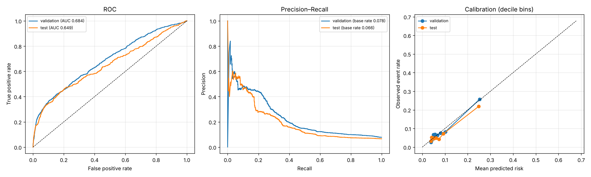
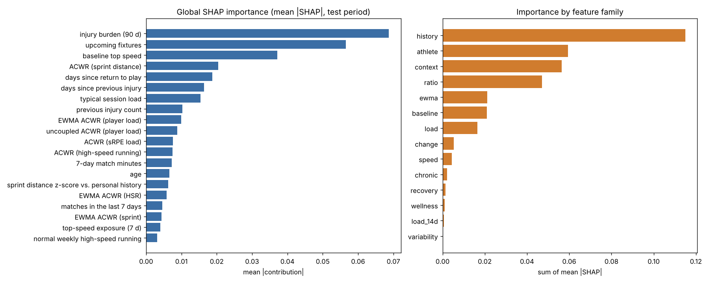

## Explainability

Every prediction returns SHAP-based **risk-increasing** and **protective** factors rendered with
athlete context, a comparison with the athlete's own baseline, and calibration context:

```text
Risk 54.0% · VERY HIGH · 6.9× base rate · 99th percentile
Current workload profile is associated with elevated historical risk. This is a statistical
estimate, not a medical assessment.

+ Injury burden (90 d): 50 days
+ ACWR (sprint distance) moved from 0.12 → 1.75 over the last 7 days
+ 2 team fixtures scheduled in the next 7 days
+ EWMA ACWR (player load) moved from 0.79 → 1.38 over the last 7 days
- Total distance over the last 7 days is 23% above the athlete's own baseline (23,291 m vs 18,978 m per week)
- RPE trend: -0.65 CR-10

Calibration: among held-out test athlete-days with similar predicted risk, 21.8% had a new
absence within 7 days (n=1,264).
```

Explanations never use deterministic language ("will get injured"); a test scans every feature
template for forbidden phrases.

## Risk engine

With a ~7 % weekly base rate, fixed 20/40/70 % cut points would label almost everyone LOW.
Categories are therefore **multiples of the reference (validation) base rate** by default —
configurable in [`configs/config.yaml`](configs/config.yaml), with an `absolute` mode:

```yaml
risk:
  mode: relative            # or: absolute
  relative_multipliers: {MODERATE: 1.5, HIGH: 2.5, VERY_HIGH: 4.0}
  absolute_thresholds:  {MODERATE: 0.20, HIGH: 0.40, VERY_HIGH: 0.70}
```

Each response exposes `risk_probability`, `risk_category`, `risk_percentile`, `relative_risk`,
the thresholds used, and `baseline_comparison` (athlete deviation from personal normal).
Sensitivity/precision at each threshold is reported in the evaluation.

## What-if simulation

`POST /simulate` appends tomorrow's planned session (the athlete's typical session, or one you
supply) to the data known today, applies scenarios (±% total load, sprint, HSR, duration, or a
recovery day), recomputes features with the production pipeline and re-scores:

| scenario (VERY HIGH winger) | simulated 7-day risk |
|---|---|
| planned session (no change) | 48.9 % |
| +20 % sprint load | 49.3 % |
| −20 % sprint load | 48.4 % |
| reduced session (−30 %) | 47.4 % |
| additional recovery day | 38.6 % |

> **Model simulation only** — shows how the model's estimate responds to a hypothetical input.
> It is not causal evidence and not medical advice. One session is ~1/7 of the acute window, so
> typical athletes move little.

## API

FastAPI with Pydantic request/response models and OpenAPI docs at `/docs`.

| method | endpoint | purpose |
|---|---|---|
| GET | `/health` | liveness / readiness, model version |
| POST | `/predict` | risk + explanation for one athlete |
| POST | `/predict/batch` | many athletes on one date (unavailable athletes reported in `skipped`) |
| GET | `/athletes` · `/athletes/{id}` | list · profile, absence history, personal baseline |
| GET | `/athletes/{id}/risk-history` | daily risk over a range |
| GET | `/athletes/{id}/workload` | daily load + rolling features |
| POST | `/simulate` | what-if scenarios |
| GET | `/model/info` · `/model/metrics` | lineage, risk-engine config · metrics, model comparison, calibration |
| GET | `/features` | feature catalogue with definitions and training ranges |
| GET | `/squad/overview` · `/squad/heatmap` | squad summary · athletes × dates risk matrix |
| GET | `/monitoring/drift` (`/html`) | drift report |

```bash
curl -X POST localhost:8000/predict -H 'content-type: application/json' \
     -d '{"athlete_id": "A102", "prediction_date": "2026-09-15"}'
```

```json
{
  "athlete_id": "A102",
  "prediction_date": "2026-09-15",
  "prediction_horizon_days": 7,
  "risk_window": {"start": "2026-09-16", "end": "2026-09-22"},
  "risk_probability": 0.0664,
  "risk_category": "LOW",
  "risk_percentile": 64.7,
  "relative_risk": 0.85,
  "top_risk_factors": [
    {"feature": "scheduled_matches_next_7d", "impact": 0.1805, "direction": "increases_risk",
     "explanation": "2 team fixture(s) scheduled in the next 7 days – associated with higher estimated risk"}
  ],
  "protective_factors": [ "…" ],
  "baseline_comparison": {"sprint_distance": {"current_7d": 65.7, "baseline_weekly": 40.6, "deviation_pct": 61.7, "z_score": 1.24, "status": "above normal"}},
  "calibration": {"bin_observed_rate": 0.0491, "test_brier": 0.0581, "interpretation": "…"},
  "model_version": "1.0.0",
  "data_origin": "synthetic",
  "disclaimer": "Statistical estimate of short-term availability risk derived from workload patterns. It is not a medical diagnosis …"
}
```

```bash
curl -X POST localhost:8000/simulate -H 'content-type: application/json' \
     -d '{"athlete_id": "A172", "scenarios": [{"sprint_load_pct": 20}, {"sprint_load_pct": -20}, {"rest_day": true}]}'
```

Errors: `404` unknown athlete · `409` athlete currently unavailable · `422` invalid input, date
outside the data, or off-season.

## Dashboard

Streamlit, five sections plus model monitoring. Colour is used by role: status colours (always
with a text label) for risk categories, a single-hue sequential ramp for the heatmap.

| Squad overview | Workload monitor |
|---|---|
| 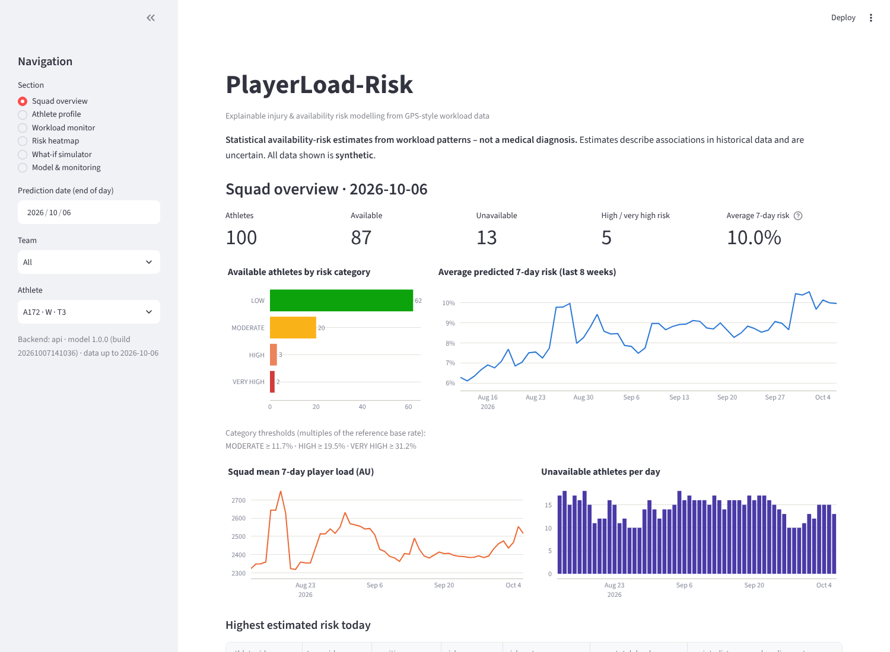 | 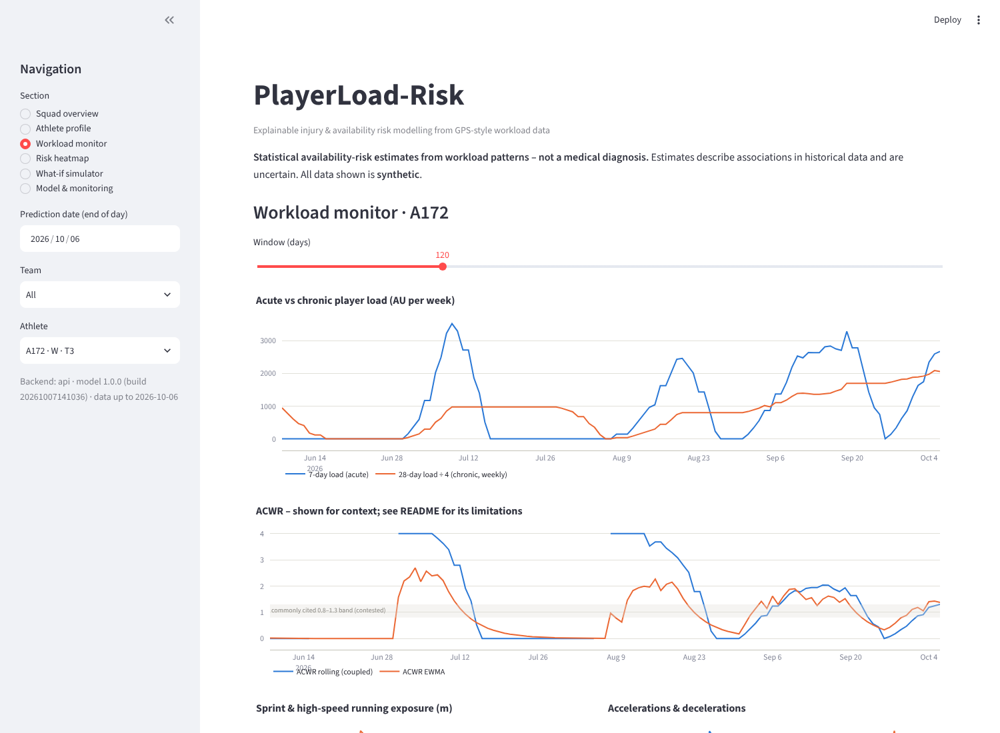 |
| **Risk heatmap** | **What-if simulator** |
| 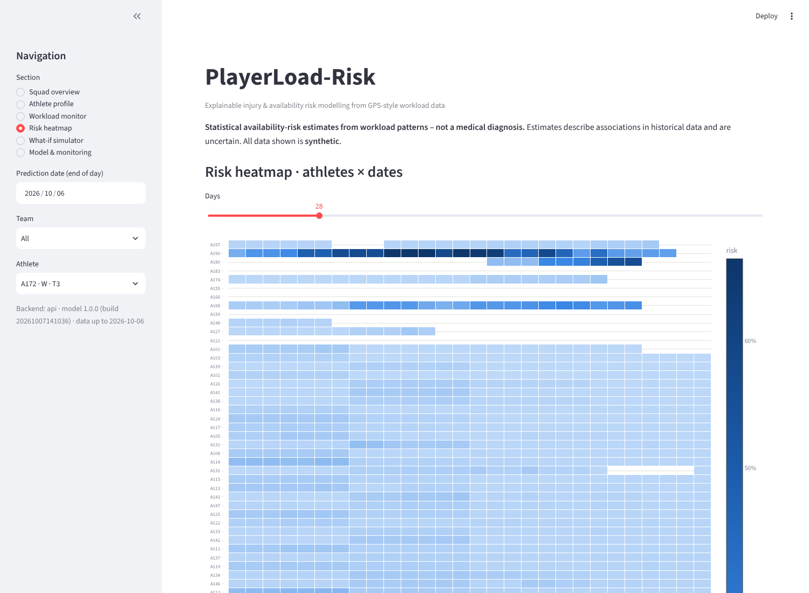 | 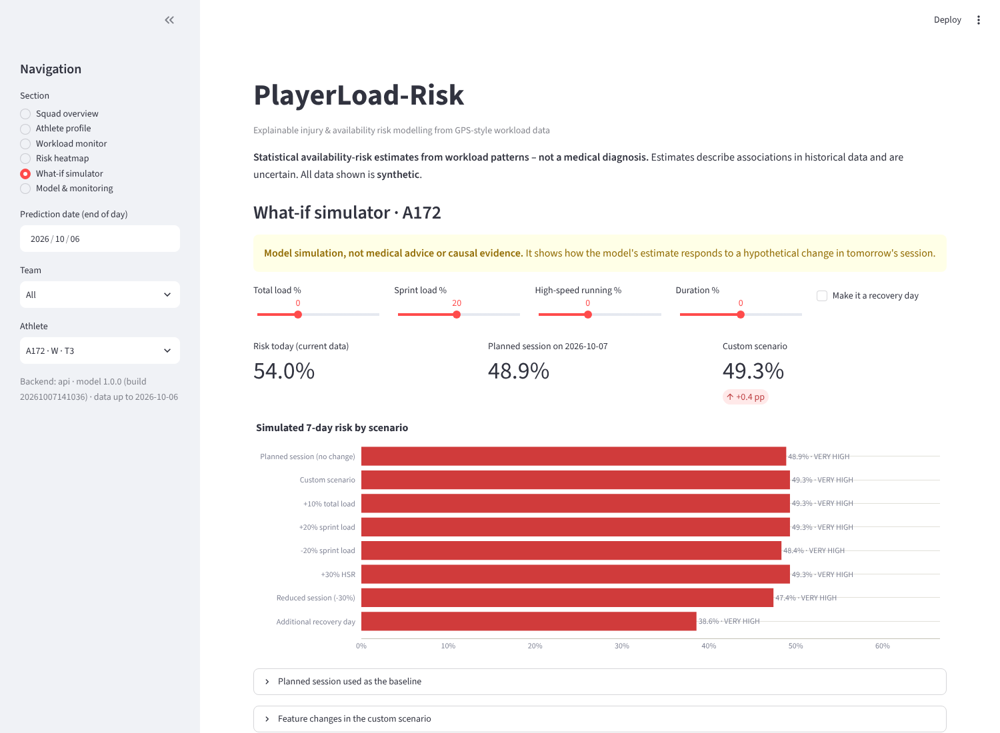 |
| **Model & monitoring** | **API docs** |
| 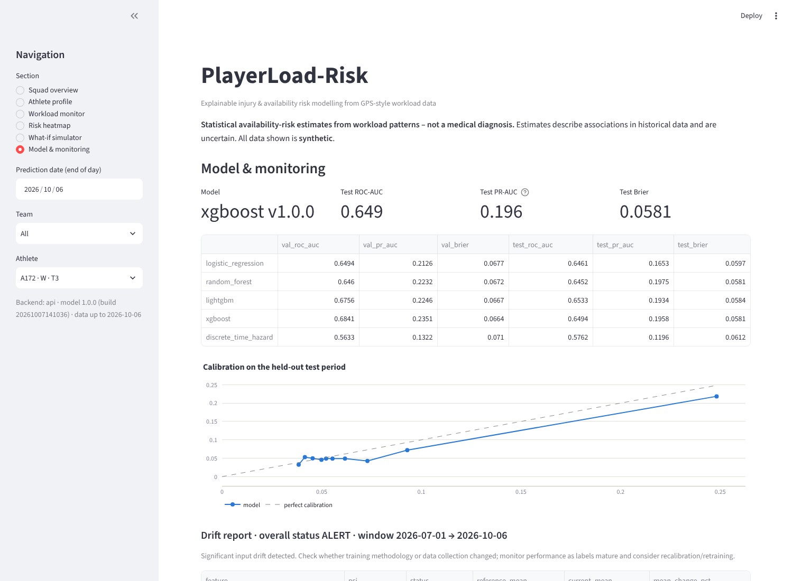 |  |

## MLOps

| concern | implementation |
|---|---|
| Configuration | single `configs/config.yaml` (hashed into every model's metadata) |
| Reproducibility | seeded generator and models; data fingerprint + config hash + git commit stored with each model; re-training is deterministic (tested) |
| Data validation | Pydantic record schemas + vectorised table checks; errors block training (`make validate`) |
| Feature schema | `models/feature_schema.json` – ordered features, units, training ranges, missing rates |
| Experiment tracking | MLflow: parent run per training, nested run per model, params/metrics/artefacts, experiments in a separate MLflow experiment |
| Model registry / versioning | MLflow Model Registry (`playerload-risk-availability-7d`, pyfunc) + local `models/registry.json` history |
| Artefact storage | `models/` bundle (joblib model, SHAP background, metadata, schema, monitoring reference); MLflow artefact store in Docker |
| Model validation | temporal hold-out, forward CV, athlete hold-out, bootstrap CIs, calibration checks, minimum-quality integration test |
| Monitoring | PSI + KS feature drift (seasonally matched reference), prediction drift, missing-value changes, label shift, performance on matured labels; JSON + HTML report; optional Evidently report if installed |
| Serving | FastAPI (`/docs`), prediction log in PostgreSQL |
| Deployment | `Dockerfile`, `docker-compose.yml` (db, mlflow, bootstrap, api, dashboard), health checks |
| CI | GitHub Actions: ruff, data validation, pytest, Docker build |

The bundled drift report flags the intentional current-season change (`rpe_mean_7d`,
`high_speed_distance_7d`, ACWR variants, prediction PSI ≈ 0.5) while matured-label performance
holds (ROC-AUC 0.662 vs 0.649 on test) — the recommendation is to monitor and recalibrate, not
to panic-retrain.

## Testing

`pytest` — 98 tests (≈ 45 s) on a small generated dataset:

* **workload maths**: rolling windows, coupled/uncoupled/EWMA ACWR, monotony, strain, edge cases
* **features**: rest/consecutive days, baselines (lagged, absence-aware), burn-in, fixtures
* **leakage**: truncation invariance, future-perturbation invariance, purged splits, observability
* **labels & splits**: label windows, season boundaries, forward folds, athlete hold-out
* **validation**: negative/impossible speeds, durations, duplicates, timestamps, IDs, overlaps
* **risk engine**: thresholds, boundaries, invalid configs; **simulation**: band consistency,
  direction of effects, no future data; **explainability**: SHAP additivity, language policy
* **API**: every endpoint, response contract, error codes, input validation
* **pipeline**: versioned bundle, minimum quality, calibration, reproducibility

## Limitations

* **Synthetic data.** Relationships were designed by the author; real-world performance is
  unknown until validated on real squads.
* **Weak individual predictability.** ROC-AUC ≈ 0.65; most flags are false alarms and most
  absences are not flagged. Many injuries (contact) and illnesses are not load-driven.
* **Associations, not causes.** Neither SHAP nor the simulator identifies causal effects of load.
* **ACWR-type features** are included for comparison, with their known statistical problems.
* **Personal tolerance** is not recovered well from few events per athlete.
* **Exposure uncertainty.** The model does not know who will play next week; the fixture
  calendar is the only forward-looking input.
* **Calibration drift.** Probabilities are calibrated to the validation period and should be
  monitored and re-calibrated as squads, coaches and seasons change.

## Ethical considerations

Workload and injury records are **health data**. Real deployments require informed consent,
data minimisation, purpose limitation, access control and retention policies under applicable
law (e.g. GDPR special-category data). Outputs are decision *support* for qualified staff, must
not be used punitively (selection, contracts, transfers), and should be communicated to athletes
with context and uncertainty. The system avoids deterministic language, exposes uncertainty
and calibration with every prediction, and is transparent about its synthetic origin. See
[`docs/model_card.md`](docs/model_card.md).

## Repository layout

```
├── api/                    FastAPI app (main.py, schemas.py, routes/)
├── configs/config.yaml     single source of configuration
├── dashboard/              Streamlit app + API/in-process backend
├── data/synthetic/         bundled synthetic dataset (+ hidden traits, audit only)
├── docker/bootstrap.sh     seed DB → train → drift report
├── docs/                   methodology, validation & leakage, data card, model card, screenshots
├── models/                 trained bundle, metadata, feature schema, registry history
├── notebooks/              exploration notebook
├── reports/                evaluation, experiments, monitoring, figures
├── src/
│   ├── data/               synthetic generator, schemas, validation, repository (DB/CSV)
│   ├── features/           workload maths, catalogue, feature pipeline, labels
│   ├── models/             splitting, estimators + calibration, metrics, registry, MLflow tracking
│   ├── explainability/     SHAP explainer, narrative generation
│   ├── risk/               risk engine
│   ├── simulation/         what-if engine
│   ├── monitoring/         drift & performance monitoring
│   └── service.py          application service used by API and dashboard
├── training/               train.py, evaluate.py, experiments/
├── scripts/                export_static.py (Netlify data), serve_web.py (local preview)
├── tests/                  pytest suite
├── web/                    static Netlify dashboard (index.html, js/, styles.css, data/, vendor/)
├── netlify.toml            Netlify publish dir, SPA rewrites, headers
├── Dockerfile · docker-compose.yml · Makefile · requirements*.txt · pyproject.toml
```

## Key references

Bahr (2016) *BJSM* · Ekstrand et al. (2011) *BJSM* · Foster (1998) *MSSE* · Foster et al. (2001)
*JSCR* · Gabbett (2016) *BJSM* · Hägglund et al. (2006) *BJSM* · Hulin et al. (2014) *BJSM* ·
Impellizzeri et al. (2020) *IJSPP* · Impellizzeri et al. (2021) *Sports Med* · Lolli et al.
(2019) *BJSM* · Lundberg & Lee (2017) *NeurIPS* · Rossi et al. (2018) *PLoS ONE* · Williams et
al. (2017) *BJSM*. Full citations in [`docs/methodology.md`](docs/methodology.md).

## License

MIT
