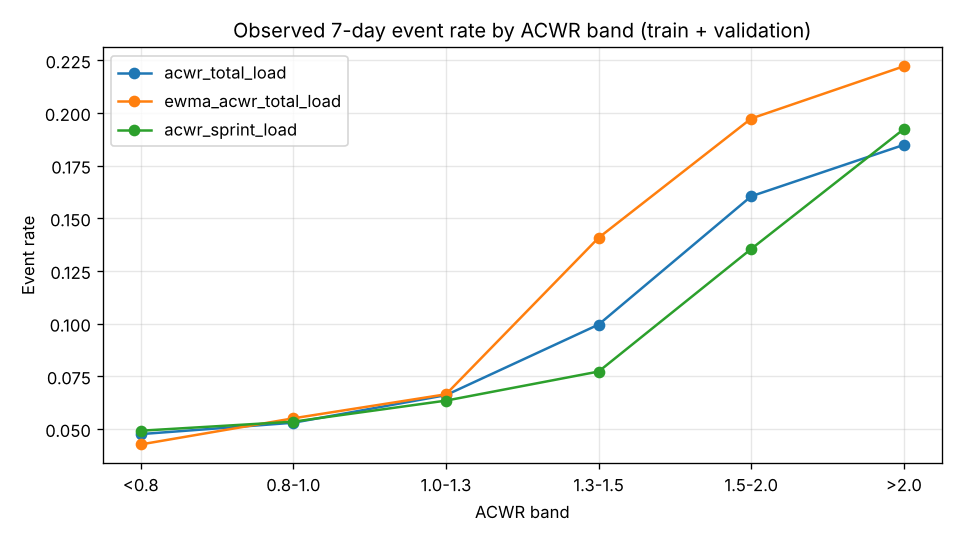

# Evaluation report – playerload-risk-availability-7d v1.0.0 (build 20261007144806)

Champion model: **xgboost** · target `availability_risk_7d` · horizon 7 days · data: **synthetic**

## Model comparison (selection on validation PR-AUC; test shown for reference only)

| model | val ROC-AUC | val PR-AUC | val Brier | test ROC-AUC | test PR-AUC | test Brier | test ECE |
|---|---|---|---|---|---|---|---|
| logistic_regression | 0.649 | 0.213 | 0.0677 | 0.646 | 0.165 | 0.0597 | 0.0231 |
| random_forest | 0.646 | 0.223 | 0.0672 | 0.645 | 0.197 | 0.0581 | 0.0163 |
| lightgbm | 0.676 | 0.225 | 0.0667 | 0.653 | 0.193 | 0.0584 | 0.0158 |
| xgboost ★ | 0.684 | 0.235 | 0.0664 | 0.649 | 0.196 | 0.0581 | 0.0129 |
| discrete_time_hazard | 0.563 | 0.132 | 0.0710 | 0.576 | 0.120 | 0.0612 | 0.0183 |

## Champion performance

| split | n | base rate | ROC-AUC (95% CI) | PR-AUC (95% CI) | Brier | Brier skill | ECE |
|---|---|---|---|---|---|---|---|
| validation | 15319 | 0.078 | 0.684 (0.625–0.738) | 0.235 (0.158–0.314) | 0.0664 | 0.077 | 0.0083 |
| test | 12635 | 0.066 | 0.649 (0.576–0.695) | 0.196 (0.125–0.259) | 0.0581 | 0.059 | 0.0129 |
| production (labelled so far) | 7744 | 0.089 | 0.662 | 0.236 | 0.0754 | 0.067 | 0.0107 |

CIs: athlete-level cluster bootstrap (200 resamples).

## Sensitivity at risk-engine thresholds (test)

| category ≥ | threshold | flagged share | sensitivity (recall) | precision | specificity |
|---|---|---|---|---|---|
| MODERATE | 0.117 | 0.095 | 0.323 | 0.225 | 0.921 |
| HIGH | 0.195 | 0.044 | 0.194 | 0.292 | 0.967 |
| VERY_HIGH | 0.312 | 0.024 | 0.152 | 0.422 | 0.985 |

Confusion matrix at the HIGH threshold (0.195): TP=162 FP=393 FN=674 TN=11406 · precision 0.292 · recall 0.194 · F1 0.233

Review-budget view (test): top 5pct → recall 0.212, lift 4.23×, top 10pct → recall 0.330, lift 3.30×, top 20pct → recall 0.439, lift 2.19×

## Forward (rolling-origin) validation

Mean ROC-AUC 0.638 ± 0.038 · mean PR-AUC 0.246

| month | n train | n test | base rate | ROC-AUC | PR-AUC |
|---|---|---|---|---|---|
| 2025-09 | 31395 | 2519 | 0.084 | 0.678 | 0.313 |
| 2025-10 | 33928 | 2652 | 0.069 | 0.619 | 0.299 |
| 2025-11 | 36573 | 2542 | 0.090 | 0.622 | 0.254 |
| 2025-12 | 39118 | 2789 | 0.052 | 0.637 | 0.214 |
| 2026-01 | 41850 | 2844 | 0.049 | 0.678 | 0.263 |
| 2026-02 | 44696 | 2524 | 0.070 | 0.639 | 0.248 |
| 2026-03 | 47250 | 2663 | 0.067 | 0.559 | 0.142 |
| 2026-04 | 49920 | 2526 | 0.090 | 0.673 | 0.235 |

## Athlete hold-out

22 athletes never seen in training: test ROC-AUC 0.688 (seen athletes: 0.631).

## Latent-trait recovery (synthetic data only)

Spearman correlation between each athlete's mean predicted risk (test period) and the hidden generator traits the model never sees:

* injury susceptibility: **+0.286**
* workload tolerance: **+0.030**
* recovery capacity: **+0.014**

## ACWR: observed event rate by band (train + validation)

| band | acwr_total_load | ewma_acwr_total_load | acwr_sprint_load |
|---|---|---|---|
| <0.8 | 0.048 (n=3962) | 0.043 (n=4199) | 0.049 (n=6518) |
| 0.8-1.0 | 0.053 (n=14699) | 0.055 (n=14646) | 0.053 (n=12435) |
| 1.0-1.3 | 0.066 (n=17352) | 0.066 (n=18681) | 0.063 (n=14852) |
| 1.3-1.5 | 0.100 (n=1879) | 0.141 (n=1869) | 0.077 (n=3097) |
| 1.5-2.0 | 0.160 (n=1365) | 0.197 (n=1622) | 0.135 (n=2112) |
| >2.0 | 0.185 (n=2581) | 0.222 (n=833) | 0.192 (n=2824) |

## Global SHAP importance (test period)

| feature | mean abs SHAP |
|---|---|
| previous_90d_injury_burden | 0.0687 |
| scheduled_matches_next_7d | 0.0565 |
| baseline_speed | 0.0372 |
| acwr_sprint_load | 0.0204 |
| days_since_return | 0.0187 |
| days_since_previous_injury | 0.0164 |
| typical_training_load | 0.0154 |
| previous_injury_count | 0.0103 |
| ewma_acwr_total_load | 0.0100 |
| acwr_total_load_uncoupled | 0.0089 |
| acwr_srpe_load | 0.0076 |
| acwr_high_speed_load | 0.0075 |
| match_minutes_7d | 0.0073 |
| age | 0.0066 |
| sprint_distance_vs_baseline_z | 0.0062 |
| ewma_acwr_high_speed_load | 0.0058 |
| matches_7d | 0.0046 |
| ewma_acwr_sprint_load | 0.0043 |
| max_speed_pct_7d | 0.0040 |
| high_speed_distance_baseline_weekly | 0.0031 |

| feature family | sum of mean abs SHAP |
|---|---|
| history | 0.1149 |
| athlete | 0.0595 |
| context | 0.0565 |
| ratio | 0.0470 |
| ewma | 0.0212 |
| baseline | 0.0210 |
| load | 0.0165 |
| change | 0.0054 |
| speed | 0.0044 |
| chronic | 0.0021 |
| recovery | 0.0015 |
| wellness | 0.0009 |
| load_14d | 0.0006 |
| variability | 0.0000 |

> Statistical estimate of short-term availability risk derived from workload patterns. It is not a medical diagnosis and does not predict any individual outcome with certainty.
